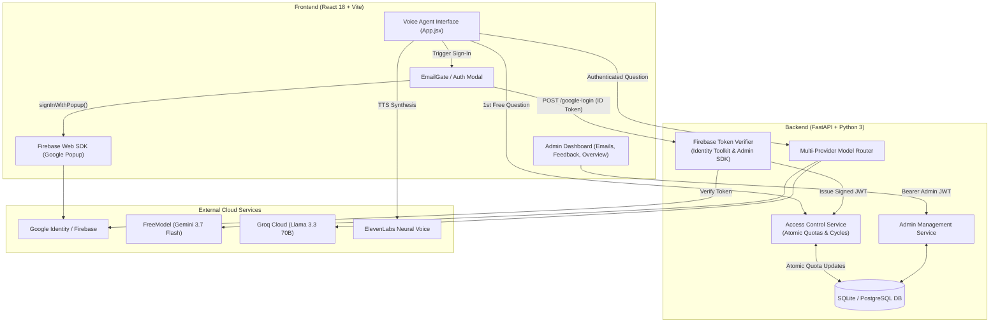

# ELIZA AI — Advanced Conversational Voice Agent & Access Control Platform

> **Production-grade AI voice assistant with multi-provider LLM routing, atomic trial question throttling, Google Firebase authentication, and a full-featured enterprise administration & analytics dashboard.**

---

## 📌 Table of Contents

1. [Project Overview](#-project-overview)
2. [Key Advantages & Highlights](#-key-advantages--highlights)
3. [System Architecture](#-system-architecture)
4. [User & Access Lifecycle (Step-by-Step)](#-user--access-lifecycle-step-by-step)
5. [Enterprise Admin Dashboard](#-enterprise-admin-dashboard)
6. [Security & Authentication Hardening](#-security--authentication-hardening)
7. [Tech Stack](#-tech-stack)
8. [Project Directory Structure](#-project-directory-structure)
9. [Step-by-Step Setup & Installation](#-step-by-step-setup--installation)
10. [Environment Variables Reference](#-environment-variables-reference)
11. [API Endpoints Reference](#-api-endpoints-reference)
12. [Testing & Verification](#-testing--verification)
13. [Deployment Guide (Vercel & Render)](#-deployment-guide-vercel--render)
14. [Admin Access Credentials](#-admin-access-credentials)

---

## 🚀 Project Overview

**ELIZA AI** is an advanced full-stack conversational voice agent platform built with **FastAPI** (Python 3) on the backend and **React 18 + Vite** on the frontend. It delivers a seamless, human-like voice interaction experience directly in modern web browsers while enforcing strict enterprise access controls, abuse prevention, and comprehensive administrative oversight.

### What Problems Does It Solve?
- **AI Cost & Abuse Mitigation**: Protects expensive LLM and text-to-speech API budgets by enforcing an atomic **3-question free trial per visitor every 20 days**, tied to verified Google accounts.
- **Hands-Free Speech Interaction**: Offers low-latency voice recognition (browser speech recognition) and natural audio playback (Web Speech API and ElevenLabs neural voices).
- **Multi-Model Reliability**: Automatically routes prompts between multiple AI providers (**Gemini 3.7 Flash**, **Groq Llama 3.3 70B**, **OpenAI GPT-4o-mini**, or **Local Offline Ollama**) to guarantee zero downtime.
- **Operational Intelligence**: Provides website owners with an enterprise-grade dark-mode administration portal to track daily visitors, inspect user questions, unblock customers, filter by date ranges, delete records, and manage UX feedback.

---

## 🌟 Key Advantages & Highlights

| Feature | Description |
| :--- | :--- |
| 🎙️ **Full Voice Interactivity** | Real-time voice capture with animated orbital orb visualizers, instant speech interruption, and natural audio synthesis. |
| 🛡️ **Atomic 3-Question / 20-Day Limit** | Server-enforced quota inside database transactions. Eliminates race conditions and prevents quota bypassing. |
| 🔐 **Google Firebase Authentication** | Streamlined Google one-click sign-in popup. No passwords or cumbersome verification emails. |
| 🔒 **Multi-Tier Server Token Verification** | Backend validates Firebase ID tokens via official Firebase Admin SDK, Google Identity Toolkit REST API, and project claims verification. Client email spoofing is mathematically impossible. |
| 🔇 **Smart Modal Voice Muting** | Voice audio and microphone recording immediately halt whenever any dialog opens (Login Gate, Limit Modal, Feedback, Settings). |
| 📊 **Pro Admin Analytics Portal** | Real-time KPI summary cards, SVG charts, device breakdowns, rating distributions, and historical logs. |
| 📅 **Calendar Date Range Filters** | Custom "From Date" to "To Date" calendar inputs on all admin tables with full-day timestamp coverage. |
| ⚡ **Admin Unblocking & Bulk Actions** | One-click instant unblocking restoring 3 trial questions, plus single-row and multi-select bulk deletions. |
| 📥 **One-Click CSV Export** | Instant client-side CSV downloads for customer registries, session history, and customer feedback. |
| 🎨 **51 Themes (36 Gradients + 15 Solids)** | 36 Atmospheric Gradient Mixed Themes (Supernova, Cosmic, Oceanic, Synthwave, Cyberpunk, Aurora) & 15 Solids with random visitor color assignment and permanent user preference locking. |
| 🗣️ **Curated Voice Library & 22 Indian Languages** | 8 ElevenLabs neural voice personas (ELIZA, ARJUN, NOVA, ALEX, KAVYA, VIKRAM, MARCUS, EMMA), 22 major Indian language locales, and independent microphone STT vs assistant TTS controls with browser fallback. |
| 🛡️ **Zero Secret Leakage** | All private API keys, database credentials, and session keys are strictly isolated to the backend. Frontend bundle contains 0 secrets. |

---

## 🏛️ System Architecture



---

## 🔄 User & Access Lifecycle (Step-by-Step)

### Step 1: Anonymous First Interaction
1. A new visitor visits the application.
2. They ask their **1st question** using voice or text without logging in.
3. The backend creates an anonymous trial session and answers the question.

### Step 2: Google Authentication Gate
1. When the visitor attempts to ask their **2nd question**, the application halts microphone capture, silences any active audio synthesis, and displays the **Google Sign-In Gate**.
2. The visitor clicks **"Continue with Google"**.
3. A Google Firebase popup appears (`signInWithPopup`).
4. Upon approval, the client retrieves the cryptographic `idToken` from Firebase and submits it to `POST /api/v1/access/google-login`.

### Step 3: Backend Cryptographic Verification
1. The backend receives the token and submits it to Google's authoritative Identity Toolkit endpoint.
2. The user's Google email and verification status are cryptographically verified.
3. The customer record is registered or retrieved in the database.
4. A signed backend session JWT is returned to the client and stored in `localStorage`.

### Step 4: Access Quota Execution (Questions 2 & 3)
1. The visitor is redirected back to the interface with their question balance visible (e.g. `2 questions remaining`).
2. The visitor asks question 2 (balance decrements to 1) and question 3 (balance decrements to 0).
3. Every question deduction executes atomically within an SQLite/PostgreSQL transaction (`record_question_deduction_atomic`).

### Step 5: Automatic 20-Day Lockout
1. Once all 3 questions have been submitted, the backend sets:
   - `questions_used = 3`
   - `status = "blocked"`
   - `blocked_until = now + 20 days`
2. Future attempts to submit questions return an immediate HTTP 403 Forbidden with the exact release timestamp.
3. The frontend displays the **Access Limit Modal**, invites the user to provide UX feedback, and disables the microphone.

---

## 📊 Enterprise Admin Dashboard

The platform includes a dedicated administration portal accessible at `/admin`:

### 1. Analytics Overview (`/admin/dashboard`)
- **Real-Time KPIs**: Total Registered Customers, Daily New Logins, Unique Visitors, Sessions Count, Currently Blocked Users, Average UX Rating.
- **Visual Analytics**: Interactive time-series charts for Daily Registrations, Question Volume, Star Rating Breakdowns (1–5 Stars), and Device Categorization (Desktop vs. Mobile vs. Tablet).
- **Preset Time Ranges**: Today, Yesterday, Last 7 Days, Last 30 Days, This Month, or Custom Date Ranges.

### 2. Email IDs & Access Analytics (`/admin/emails`)
- **Searchable & Sortable Table**: Filter by customer email, access status (`eligible`, `blocked`, `active`, `expired`), question balance (`0/3`, `1/3`, `2/3`, `3/3`), and device category.
- **Calendar Date Range Filter**: "From Date" and "To Date" date pickers to isolate registrations across specific campaigns or intervals.
- **Multi-Select & Bulk Delete**: Header master checkbox and row checkboxes with a floating action bar to delete multiple accounts simultaneously.
- **Customer Unblocking Action**: One-click **"Unblock"** button on blocked rows and in the Customer Detail Drawer to instantly reset questions used to 0 and restore trial access.
- **CSV Data Export**: Export the entire customer registry into an Excel-compatible CSV file.

### 3. Feedback & Reviews Management (`/admin/feedback`)
- **Review Categorization**: Filter by category (`Voice Experience`, `Answer Quality`, `UI/UX`, `Bug`, `Feature Request`).
- **Rating Filtering**: Filter by star rating (1 to 5 stars).
- **Status Workflow**: Interactive status toggle (`New` ➜ `Reviewed` ➜ `Resolved`).
- **Internal Admin Notes**: Persistent note-taking for team collaboration and follow-up tracking.
- **Single & Bulk Deletion**: Cleanly erase feedback entries.
- **Feedback CSV Export**: One-click export of customer ratings, feedback messages, and browser/device metadata.

---

## 🔒 Security & Authentication Hardening

1. **Client/Server Secret Separation**:
   - Web API keys in `frontend/.env` (`VITE_FIREBASE_API_KEY`, etc.) are public client identifiers restricted via HTTP referrers in Google Cloud Console.
   - True server secrets (`FREEMODEL_API_KEY`, `SESSION_SECRET_KEY`, `ADMIN_PASSWORD`) exist exclusively in `backend/.env`.
   - Automated AST scans confirm **0 server secrets leaked** in compiled frontend assets (`dist/assets/*.js`).
2. **Protection Against Email Spoofing**:
   - The backend never accepts client-provided plaintext emails during login. The email is extracted exclusively from Google's verified cryptographic token payload.
3. **Database Concurrency & Idempotency**:
   - Quota deductions use transactional locks (`with_for_update`) with UUID idempotency keys (`request_id`) to prevent parallel duplicate request attacks.
4. **Security Middleware Stack**:
   - `CorrelationIdMiddleware`: Injects a unique `X-Correlation-ID` header into every request for distributed tracing.
   - `SecurityHeadersMiddleware`: Enforces `X-Content-Type-Options: nosniff`, `X-Frame-Options: DENY`, `X-XSS-Protection: 1`, and `Referrer-Policy: strict-origin-when-cross-origin`.
   - `RequestSizeLimitMiddleware`: Blocks payloads exceeding 1MB to prevent memory exhaustion attacks.
   - `GeneralLimiter`: In-memory IP rate limiter protecting `/api/v1/access/*` endpoints.

---

## 💻 Tech Stack

### Frontend
- **Framework**: React 18 with Vite
- **Styling**: Tailwind CSS + Custom CSS Variables (15 Solid Themes + 5 Gradient Themes)
- **Icons**: Lucide React
- **Authentication**: Firebase Web SDK v10 (Google Auth Provider)
- **Speech APIs**: Web Speech Recognition API + Web SpeechSynthesis API

### Backend
- **Framework**: FastAPI (Python 3.10+)
- **Server**: Uvicorn (ASGI)
- **Database & ORM**: SQLAlchemy 2.0 with SQLite (local) / PostgreSQL (production)
- **Authentication**: Python-Jose (JWT HS256), Passlib (Bcrypt)
- **SDKs & HTTP**: Firebase Admin SDK, HTTPX, Pydantic v2
- **Testing**: Pytest, FastAPI TestClient

---

## 📁 Project Directory Structure

```text
eliza-ai/
├── backend/
│   ├── app/
│   │   ├── core/
│   │   │   ├── config.py             # Settings, origins & environment loading
│   │   │   └── security.py           # Rate limiting & security middlewares
│   │   ├── routes/
│   │   │   ├── access.py             # Verify email, Google login, session status
│   │   │   ├── admin.py              # Overview, emails, feedback, unblock & deletions
│   │   │   ├── feedback.py           # Visitor feedback submission
│   │   │   └── questions.py          # Chat & question generation routes
│   │   ├── services/
│   │   │   ├── access_control.py     # Atomic quota tracking & 20-day cycles
│   │   │   ├── admin_service.py      # Admin metrics, filtering, unblock & delete logic
│   │   │   ├── firebase_admin.py     # 4-tier cryptographic token verification
│   │   │   └── model_router.py       # Multi-LLM provider fallback router
│   │   ├── db.py                     # Database engine & session maker
│   │   ├── models.py                 # Customer, AccessPeriod, QuestionUsage, Feedback, Admin
│   │   ├── schemas.py                # Pydantic request/response validation schemas
│   │   └── main.py                   # FastAPI application initialization & middlewares
│   ├── tests/
│   │   ├── test_access_control.py    # Quota deduction & 20-day block test suite
│   │   ├── test_firebase_and_admin_security.py # Token validation & admin actions tests
│   │   ├── test_health.py            # API health checks
│   │   └── test_security.py          # Headers, rate limits & payload size tests
│   ├── data/                         # SQLite databases & conversation files
│   ├── .env.example                  # Template of backend environment variables
│   └── requirements.txt              # Python package dependencies
│
└── frontend/
    ├── src/
    │   ├── components/
    │   │   └── AdminLayout.jsx       # Sticky header, responsive shell & navigation
    │   ├── pages/
    │   │   ├── admin/
    │   │   │   ├── AdminLogin.jsx    # Administrator login portal
    │   │   │   ├── Dashboard.jsx     # Overview KPIs, charts & time presets
    │   │   │   ├── EmailsPage.jsx    # User registry, date filter, unblock & bulk delete
    │   │   │   └── FeedbackPage.jsx  # Feedback table, status editor & notes drawer
    │   │   ├── EmailGate.jsx         # Google Auth popup modal
    │   │   ├── LimitModal.jsx        # Quota exhausted notification & countdown
    │   │   ├── FeedbackForm.jsx      # Post-limit customer feedback dialog
    │   │   └── SettingsDrawer.jsx    # Model & voice configuration drawer
    │   ├── services/
    │   │   ├── accessApi.js          # Client for access & Google auth routes
    │   │   ├── adminApi.js           # Client for admin endpoints & JWT storage
    │   │   └── firebase.js           # Firebase app initialization & Google popup
    │   ├── App.jsx                   # Main conversational voice interface
    │   ├── AppWrapper.jsx            # State coordinator, modal controller & audio silencer
    │   └── main.jsx                  # React application root
    ├── dist/                         # Production-optimized build bundle
    ├── .env                          # Frontend environment variables
    ├── package.json                  # Node dependencies & build scripts
    └── vite.config.js                # Vite build configuration & COOP headers
```

---

## 🛠️ Step-by-Step Setup & Installation

### Prerequisites
- **Node.js**: v18.0 or higher
- **Python**: v3.10, v3.11, or v3.12
- **Git**

---

### Step 1: Clone the Repositories

```bash
# Clone Backend Repository
git clone https://github.com/AKHILTHADAKA97/eliza-ai-voice-agent_bd.git backend

# Clone Frontend Repository
git clone https://github.com/AKHILTHADAKA97/eliza-ai-voice-agent_fd.git frontend
```

---

### Step 2: Configure Backend

1. Navigate to the `backend` directory:
   ```bash
   cd backend
   ```
2. Create and activate a Python virtual environment:
   ```bash
   # Windows
   python -m venv .venv
   .venv\Scripts\activate

   # macOS / Linux
   python3 -m venv .venv
   source .venv/bin/activate
   ```
3. Install required packages:
   ```bash
   pip install -r requirements.txt
   ```
4. Create a `.env` file in `backend/`:
   ```ini
   APP_NAME="ELIZA AI"
   ENVIRONMENT=development
   HOST=127.0.0.1
   PORT=8000
   FRONTEND_ORIGIN=http://localhost:5174

   # Security & Session Secrets
   SESSION_SECRET_KEY=generate_a_secure_32_character_random_string_here

   # LLM Providers (Configure at least one)
   FREEMODEL_API_KEY=your_freemodel_api_key
   FREEMODEL_BASE_URL=https://freemodel.in/v1
   FREEMODEL_MODEL=gemini-3.7-flash

   # Groq (Optional free alternative)
   GROQ_API_KEY=your_groq_api_key
   GROQ_MODEL=llama-3.3-70b-versatile

   # Default Admin Credentials
   ADMIN_USERNAME=hello.superui@gmail.com
   ADMIN_EMAIL=hello.superui@gmail.com
   ADMIN_PASSWORD=Sravanthi@7777

   # Firebase Token Verification
   FIREBASE_PROJECT_ID=elizaaivoice
   FIREBASE_API_KEY=your_firebase_web_api_key
   ```
5. Launch the backend server:
   ```bash
   uvicorn app.main:app --host 127.0.0.1 --port 8000 --reload
   ```
   *The database tables and initial administrator will seed automatically on startup.*

---

### Step 3: Configure Frontend

1. Open a new terminal and navigate to the `frontend` directory:
   ```bash
   cd frontend
   ```
2. Install dependencies:
   ```bash
   npm install
   ```
3. Create a `.env` file in `frontend/`:
   ```ini
   VITE_API_BASE_URL=http://localhost:8000

   # Firebase Web Configuration (Public)
   VITE_FIREBASE_API_KEY=your_firebase_web_api_key
   VITE_FIREBASE_AUTH_DOMAIN=elizaaivoice.firebaseapp.com
   VITE_FIREBASE_PROJECT_ID=elizaaivoice
   VITE_FIREBASE_STORAGE_BUCKET=elizaaivoice.firebasestorage.app
   VITE_FIREBASE_MESSAGING_SENDER_ID=826705071135
   VITE_FIREBASE_APP_ID=1:826705071135:web:b6997ba92c34349ae9992a
   ```
4. Start the frontend dev server:
   ```bash
   npm run dev -- --port 5174
   ```
5. Open your browser and navigate to:
   - **Voice Agent Interface**: `http://localhost:5174`
   - **Admin Login Portal**: `http://localhost:5174/admin/login`

---

## 🔑 Environment Variables Reference

### Backend (`backend/.env`)

| Variable | Required | Description | Example |
| :--- | :---: | :--- | :--- |
| `SESSION_SECRET_KEY` | **Yes** | 256-bit secret key used to sign user and admin JWTs. | Random 32+ char string |
| `FREEMODEL_API_KEY` | Optional | API key for FreeModel (Gemini 3.7 Flash). | `fm_...` |
| `GROQ_API_KEY` | Optional | Ultra-fast Groq Llama 3.3 API key. | `gsk_...` |
| `OPENAI_API_KEY` | Optional | Official OpenAI platform API key. | `sk-...` |
| `ADMIN_USERNAME` | **Yes** | Primary administrator login username/email. | `hello.superui@gmail.com` |
| `ADMIN_PASSWORD` | **Yes** | Administrator account password. | `Sravanthi@7777` |
| `FIREBASE_PROJECT_ID` | **Yes** | Project ID for Firebase ID token verification. | `elizaaivoice` |
| `FIREBASE_API_KEY` | **Yes** | Web API key used for Google Identity Toolkit verification. | `AIzaSy...` |
| `DATABASE_URL` | Optional | Database connection URI (defaults to SQLite). | `postgresql://...` |

### Frontend (`frontend/.env`)

| Variable | Required | Description |
| :--- | :---: | :--- |
| `VITE_API_BASE_URL` | **Yes** | Backend URL (e.g. `http://localhost:8000` or Render URL). |
| `VITE_FIREBASE_API_KEY` | **Yes** | Firebase Web API key for Google popup sign-in. |
| `VITE_FIREBASE_AUTH_DOMAIN` | **Yes** | Firebase authentication domain (`*.firebaseapp.com`). |
| `VITE_FIREBASE_PROJECT_ID` | **Yes** | Firebase project identifier (`elizaaivoice`). |
| `VITE_FIREBASE_APP_ID` | **Yes** | Firebase web application identifier. |

---

## 🌐 API Endpoints Reference

### Public Visitor & Access Endpoints
- `POST /api/v1/access/verify-email`: Validates email and returns quota status.
- `POST /api/v1/access/google-login`: Verifies Google ID token, registers customer, and returns JWT session.
- `GET /api/v1/access/status`: Inspects live remaining question balance from session token.
- `POST /api/v1/questions/ask`: Submits a question, atomically deducts 1 question, and returns AI answer.
- `POST /api/v1/feedback`: Submits customer rating, feedback message, and device metadata.

### Administrator Endpoints (`Authorization: Bearer <ADMIN_JWT>`)
- `POST /api/v1/admin/login`: Authenticates administrator with username/password.
- `GET /api/v1/admin/me`: Returns profile of authenticated admin.
- `POST /api/v1/admin/logout`: Stateless logout confirmation.
- `GET /api/v1/admin/dashboard/overview`: Summary metrics, time-series chart data, and device breakdowns.
- `GET /api/v1/admin/dashboard/emails`: Searchable, filterable, and paginated customer list.
- `GET /api/v1/admin/dashboard/emails/{id}`: Detailed customer profile, question logs, and access cycles.
- `POST /api/v1/admin/customers/{id}/unblock`: **Unblocks user**, resets questions used to 0, restores 3 questions.
- `DELETE /api/v1/admin/customers/{id}`: Permanently deletes a single customer and associated records.
- `POST /api/v1/admin/customers/bulk-delete`: Bulk deletes selected customers by ID array.
- `GET /api/v1/admin/dashboard/feedback`: Paginated feedback reviews with rating and category filters.
- `PATCH /api/v1/admin/dashboard/feedback/{id}`: Updates review status (`new`, `reviewed`, `resolved`) and admin notes.
- `DELETE /api/v1/admin/feedback/{id}`: Permanently deletes a single feedback review.
- `POST /api/v1/admin/feedback/bulk-delete`: Bulk deletes selected feedback reviews.

---

## 🧪 Testing & Verification

The backend includes a comprehensive automated test suite covering access quotas, 20-day locks, token security, and admin actions.

Run tests using `pytest`:
```bash
cd backend
.venv\Scripts\activate
pytest tests
```

Expected output:
```text
============================= test session starts =============================
platform win32 -- Python 3.14.6, pytest-9.2.0, pluggy-1.7.0
rootdir: eliza-ai/backend
configfile: pytest.ini
collected 29 items

tests\test_access_control.py ............                                [ 41%]
tests\test_firebase_and_admin_security.py ......                         [ 62%]
tests\test_health.py ...                                                 [ 72%]
tests\test_security.py ........                                          [100%]

============================= 29 passed in 12.55s =============================
```

---

## 🚀 Deployment Guide (Vercel & Render)

### Frontend Deployment (Vercel)
1. Push `frontend` to your GitHub repository.
2. In the Vercel Dashboard, import the repository.
3. Configure the **Build Settings**:
   - Framework Preset: `Vite`
   - Build Command: `npm run build`
   - Output Directory: `dist`
4. Add Environment Variables:
   - `VITE_API_BASE_URL`: Your deployed backend URL on Render (e.g. `https://eliza-ai-voice-agent-bd.onrender.com`).
   - Copy all `VITE_FIREBASE_*` variables from `frontend/.env`.
5. Deploy.

### Backend Deployment (Render)
1. In Render, select **New Web Service** and connect the `backend` repository.
2. Configure settings:
   - Environment: `Python 3`
   - Build Command: `pip install -r requirements.txt`
   - Start Command: `uvicorn app.main:app --host 0.0.0.0 --port $PORT`
3. Add Environment Variables:
   - `ENVIRONMENT=production`
   - `FRONTEND_ORIGIN=https://your-vercel-domain.vercel.app`
   - `SESSION_SECRET_KEY=your_secure_random_key`
   - `ADMIN_USERNAME=hello.superui@gmail.com`
   - `ADMIN_PASSWORD=Sravanthi@7777`
   - `FIREBASE_PROJECT_ID=elizaaivoice`
   - `FIREBASE_API_KEY=AIzaSy...`
   - Add your AI model keys (`FREEMODEL_API_KEY`, `GROQ_API_KEY`, etc.).
4. Deploy.

### Firebase Console Authorized Domains
In the [Firebase Console](https://console.firebase.google.com/):
1. Navigate to **Authentication** > **Settings** > **Authorized domains**.
2. Add your production and development domains:
   - `localhost`
   - `your-vercel-domain.vercel.app`

---

## 🔐 Admin Access Credentials

- **Admin Login URL**: [`/admin/login`](http://localhost:5174/admin/login)
- **Default Username**: `hello.superui@gmail.com`
- **Default Password**: `Sravanthi@7777`
- **Email Access Table**: [`/admin/emails`](http://localhost:5174/admin/emails)
- **Feedback & Reviews**: [`/admin/feedback`](http://localhost:5174/admin/feedback)

---

## 📄 License
This project is proprietary software developed for the ELIZA AI Conversational Voice Platform. All rights reserved.
